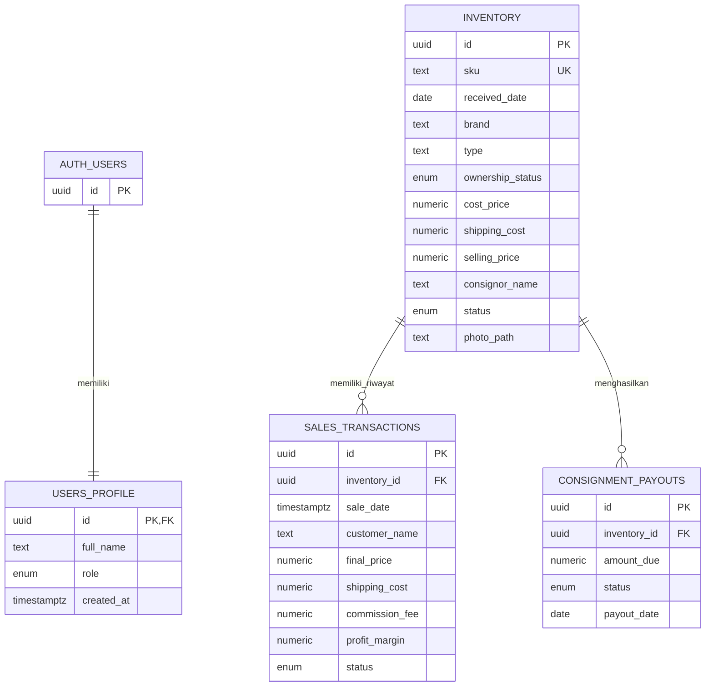

# Sistem Informasi Akuntansi Raket Mantan

**Demo aplikasi:** [Buka Raket Mantan Accounting v2](https://warihh.github.io/raketmantan-accounting-v2/frontend/)

Demo Login Apps:
Gmail: testakun@gmail.com
Kata Sandi: admin123

## Identitas Tugas

- **Nama:** Wahab Warih Timur Priyanto
- **NIM:** 12030123140354
- **Mata Kuliah:** Pengkodean dan Pemrogaman
- **Kelas:** E
- **Dosen Pengampu:** Dr. Totok Dewayanto, S.E., M.Si., Akt.

Disusun untuk memenuhi Tugas Project UTS Pengkodean dan Pemrogaman.

## Penjelasan Sistem

Raket Mantan Accounting v2 adalah aplikasi pencatatan persediaan dan siklus penjualan raket padel, termasuk barang milik sendiri dan barang titipan (consignment). Aplikasi menyediakan dashboard ringkas, pencatatan transaksi, perhitungan laba atau komisi, serta pemantauan kewajiban pembayaran kepada penitip.

Autentikasi, data, dan foto persediaan dikelola menggunakan Supabase. Proses penjualan, perubahan stok, dan pembuatan payout dijalankan dalam satu transaksi database melalui PostgreSQL RPC agar perubahan utamanya konsisten.

## Fitur

- Registrasi, login, dan logout menggunakan Supabase Auth.
- Profil pengguna dengan role `admin` atau `owner`.
- CRUD persediaan: SKU, tanggal masuk, merek, tipe, shape, kondisi, kepemilikan, modal, biaya, harga jual, penitip, dan foto.
- Pencarian dan filter persediaan berdasarkan kepemilikan serta status.
- Pencatatan transaksi penjualan dengan status `completed` atau `refunded`.
- Perhitungan estimasi laba atau komisi sebelum transaksi disimpan.
- Edit tanggal, nama pembeli, harga, komisi, dan ongkir transaksi.
- Refund mengembalikan status raket menjadi tersedia dan membatalkan payout yang masih pending.
- Payout consignment dapat dipantau dan ditandai sudah dibayar.
- Dashboard menampilkan laba bulan berjalan, hutang consignment, jumlah raket terjual/tersedia, penjualan terbaru, dan payout pending.
- Foto raket JPG, PNG, atau WebP dengan batas ukuran 5 MB.

## Logika Akuntansi

Perhitungan menggunakan nilai dalam rupiah. Ongkir masuk disimpan pada persediaan, sedangkan ongkir penjualan dicatat pada transaksi.

| Jenis kepemilikan | Laba yang dicatat | Kewajiban kepada penitip |
| --- | --- | --- |
| Milik sendiri | Harga jual final - harga modal - ongkir masuk - ongkir penjualan | Tidak ada |
| Consignment | Komisi - ongkir masuk - ongkir penjualan | Harga jual final - komisi |

Alur transaksi:

1. Saat transaksi berstatus `completed`, sistem menyimpan penjualan dan mengubah status persediaan menjadi `terjual`.
2. Untuk barang consignment, sistem membuat payout berstatus `pending` sebesar harga jual final dikurangi komisi.
3. Saat payout dibayar, status berubah menjadi `paid` dan tanggal pembayaran dicatat.
4. Saat transaksi di-refund, status penjualan menjadi `refunded`, stok kembali tersedia, dan payout `pending` terkait dihapus.
5. Laba dashboard hanya menjumlahkan transaksi `completed`. Perubahan harga atau komisi memperbarui payout yang masih pending; perubahan nilai ditolak jika payout terkait sudah dibayar.

**Contoh:** raket consignment terjual Rp3.000.000 dengan komisi Rp300.000. Hak penitip adalah Rp2.700.000. Jika ongkir masuk Rp20.000 dan ongkir penjualan Rp10.000, laba/komisi bersih yang dicatat adalah Rp270.000.

## ERD



`AUTH_USERS` dikelola oleh Supabase Auth. Setiap profil terhubung ke satu akun autentikasi. Satu unit persediaan dapat memiliki riwayat transaksi dan payout; tabel payout menunjuk ke persediaan, bukan langsung ke transaksi.

## Struktur Folder

```text
.
├── .github/
│   └── workflows/
│       └── pages.yml          # Deployment demo ke GitHub Pages
├── assets/                    # Logo dan banner
├── backend/
│   └── app.js                  # UI, event, dan alur aplikasi browser
├── database/
│   └── schema.sql              # Skema, RPC, trigger, dan policy Supabase
├── frontend/
│   ├── index.html              # Halaman aplikasi
│   ├── style.css               # Gaya dan layout responsif
│   └── supabase-config.js      # Klien Supabase dan operasi data
└── README.md
```

## Teknologi

- HTML5, CSS3, dan JavaScript.
- Tailwind CSS dan Font Awesome melalui CDN.
- Supabase Auth, PostgreSQL, Row Level Security (RLS), Storage, dan JavaScript client.
- GitHub Actions dan GitHub Pages untuk deployment demo statis.

## Menjalankan Lokal

1. Buat project Supabase dan jalankan `database/schema.sql` melalui SQL Editor.
2. Pastikan URL project dan anon/publishable key di `frontend/supabase-config.js` sesuai dengan project Supabase yang digunakan.
3. Atur Email provider dan Email Confirmation pada Supabase Authentication sesuai kebutuhan.
4. Buka `frontend/index.html` menggunakan Live Server.

## Deployment Demo

Workflow di `.github/workflows/pages.yml` menerbitkan frontend beserta folder aset dan script pendukung ke GitHub Pages setiap ada push ke branch `main`. Demo tersedia di [warihh.github.io/raketmantan-accounting-v2/frontend](https://warihh.github.io/raketmantan-accounting-v2/frontend/). Jika deployment pertama belum aktif, periksa status workflow **Deploy GitHub Pages** pada tab **Actions** repository.

## Catatan Penting dan Batasan

- Demo bersifat publik dan menggunakan project Supabase yang dikonfigurasi aplikasi. Gunakan data uji, bukan data pelanggan atau transaksi nyata.
- Registrasi publik dapat memilih role `owner` atau `admin`; role dari metadata registrasi ini hanya sesuai untuk demo.
- Policy RLS saat ini mengizinkan semua pengguna terautentikasi mengelola data operasional bersama. RLS bukan pembatas akses per pengguna/organisasi.
- Supabase anon/publishable key memang digunakan di browser; keamanan tetap bergantung pada RLS. Jangan pernah memasukkan `service_role` key ke frontend atau repository.
- Bucket foto bersifat publik agar gambar dapat ditampilkan melalui URL publik.
- Aplikasi berfokus pada persediaan, penjualan, laba/komisi, dan payout. Aplikasi belum membuat jurnal berpasangan, buku besar, neraca, atau laporan keuangan formal.
- Sebelum penggunaan produksi, batasi pendaftaran dan role, perketat policy RLS, tinjau proses refund/payout, dan siapkan pencadangan serta audit trail.
